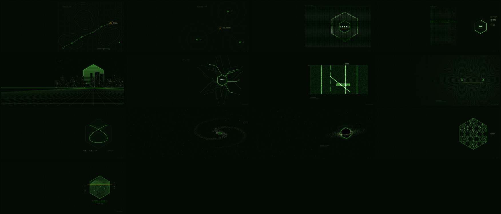
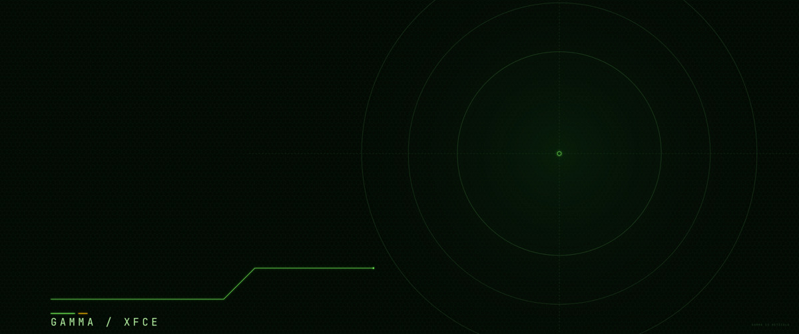
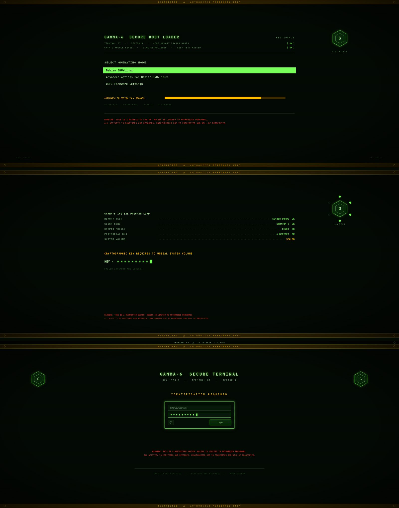

<!--
  File / Arquivo: README.md
  Project / Projeto: GAMMA Debian (Contador theme)
  Version / Versão: 1.1.0
  Date / Data: 21/11/2026 22:55 (America/Sao_Paulo)
  Author / Autoria: lstavares84, with / com Claude Opus 5.5 (Anthropic)
-->

# GAMMA Debian · Contador

**[English](#english) | [Português](#português)**


---

## English

A complete desktop theme for **Debian 13 (Trixie) with XFCE 4.20**, built in the
same visual language as [GAMMA](https://github.com/lstavares84/turzx), a
monitoring dashboard for a 3.5" USB screen.

The look is a scientific instrument in a control room: fluorescent green on an
almost black background, like a radiation counter or a green phosphor
oscilloscope. The guiding idea of the "Contador" (counter) direction is simple:
**the interface only glows where something is happening.** The focused window,
the selected item, the field being edited and the measured value light up;
everything else recedes into dim green.

Hexagons are the visual signature (check boxes, radio buttons, sliders, window
buttons, wallpapers), and state colors have a fixed meaning everywhere:
**green** normal, **amber** warning, **red** critical, **grey** no data.

### Contents

- [What is included](#what-is-included)
- [Screenshots](#screenshots)
- [Palette](#palette)
- [Requirements](#requirements)
- [Install](#install)
- [What the installer changes](#what-the-installer-changes)
- [Rotating wallpapers](#rotating-wallpapers)
- [Boot and login screens](#boot-and-login-screens)
- [Restore or uninstall](#restore-or-uninstall)
- [Customizing](#customizing)
- [Rebuilding the generated files](#rebuilding-the-generated-files)
- [Repository layout](#repository-layout)
- [Known limitations](#known-limitations)
- [Troubleshooting](#troubleshooting)
- [Credits and licenses](#credits-and-licenses)

### What is included

| Part | Source | Installed to |
|---|---|---|
| GTK 3 theme (plus a basic GTK 2 theme) | `tema/GAMMA/gtk-3.0`, `gtk-2.0` | `~/.themes/GAMMA` |
| xfwm4 window frames with hexagonal buttons | `tema/GAMMA/xfwm4` | `~/.themes/GAMMA` |
| xfce4-notifyd notifications | `tema/GAMMA/xfce-notify-4.0` | `~/.themes/GAMMA` |
| Original cursor theme (17 shapes, 112 names, animated busy cursor) | `cursor/GAMMA-cursor` | `~/.icons/GAMMA-cursor` |
| Icons: Papirus-Dark with folders recolored to the palette | generated by `icones/gerar_icones.py` | `~/.icons/GAMMA` |
| xfce4-terminal color scheme (16 ANSI colors) | `terminal/gamma.theme` | `~/.local/share/xfce4/terminal/colorschemes` |
| Editor scheme (GtkSourceView 4: Mousepad and others) | `editor/gamma.xml` | `~/.local/share/gtksourceview-4/styles` |
| 26 original wallpapers in two series, 3440x1440 and 2560x1080 | `wallpapers/` | `~/.local/share/backgrounds/gamma` |
| Roboto and JetBrains Mono fonts | `fontes/` | `~/.local/share/fonts/gamma` |
| GRUB, Plymouth and LightDM login screens (optional, needs sudo) | `sistema/` | see [Boot and login screens](#boot-and-login-screens) |
| Visual identity book (22-page PDF) and mockups | `book/`, `mockups/` | |

### Screenshots

**Series 1, laboratory (01 to 13):** Nucleus, Half-life, Decay chain, Count,
Oscilloscope, Honeycomb, Orbit, Topology, Gamma spectrum, Sweep, Phosphor,
Silence and Reticle.


**Series 2, no nuclear references (14 to 26):** Tactical (military map),
Triangulation (signal interception), Cipher (one-time pad), Intrusion (hacking),
Neon (cyberpunk city), Circuit (control board), Spectrogram, Interference,
Lissajous, Galaxy, Event horizon, Fractal (hexaflake) and Biometrics.






### Palette

| Name | Hex | Role |
|---|---|---|
| bg | `#030A04` | main background |
| accent | `#78FF5A` | titles, selection, focus, active icons |
| ice | `#BEFFAA` | main text and normal values |
| white | `#E6FFE1` | high emphasis neutral text (always slightly green) |
| sub | `#6EAA6E` | labels, secondary and disabled text |
| dim | `#234B23` | borders, dividers, grids (never text) |
| amber | `#FFBE00` | warning |
| red | `#FF3C32` | error, critical |

State surfaces (fill / border):

| State | Fill | Border |
|---|---|---|
| OK | `#0A300C` | `#78FF5A` |
| Warning | `#3C2C00` | `#FFBE00` |
| Critical | `#480404` | `#FF3C32` |
| No data | `#081209` | `#1E341E` |
| Neutral | `#081C0A` | `#40783C` |

Decorative background: a mesh of small hexagons (radius 11 px) in `#0A1A0B`
over `#030A04`.

Terminal ANSI colors. Entries marked with ◆ are derived, so that tools which rely
on blue, magenta and cyan (ls, git, vim) keep distinct colors without leaving the
green family: blue becomes teal, magenta becomes lime and cyan becomes mint.

| # | Normal | # | Bright |
|---|---|---|---|
| 0 black | `#0A1A0B` ◆ | 8 | `#40783C` |
| 1 red | `#FF3C32` | 9 | `#FF7A6E` ◆ |
| 2 green | `#5ADC3C` ◆ | 10 | `#78FF5A` |
| 3 yellow | `#FFBE00` | 11 | `#FFD75A` ◆ |
| 4 blue | `#3CB49B` ◆ | 12 | `#6EE6C8` ◆ |
| 5 magenta | `#C8E632` ◆ | 13 | `#E1FF78` ◆ |
| 6 cyan | `#8CF0BE` ◆ | 14 | `#BEFFE1` ◆ |
| 7 white | `#BEFFAA` | 15 | `#E6FFE1` |

Typography: **Roboto** for the interface (Bold for titles) and **JetBrains Mono**
for numbers, the terminal and data. Both are under the SIL Open Font License.

### Requirements

- Debian 13 (Trixie) with XFCE 4.20 on X11 (tested with xfwm4 4.20.0,
  xfdesktop 4.20.1, xfce4-panel 4.20.4, xfce4-terminal 1.1.4, Mousepad 0.6.3)
- `python3`, `xfconf-query`, `fc-cache` (all present in a standard XFCE install)
- Optional: `papirus-icon-theme` for the icons, `python3-gi` for the test window,
  `x11-apps` (xcursorgen) only to rebuild the cursor

### Install

```bash
git clone https://github.com/lstavares84/gamma_debian_theme.git
```

```bash
cd gamma_debian_theme && ./instalar.sh
```

No sudo is needed. Everything goes into your home folder. Options:

| Option | Effect |
|---|---|
| `--sem-aplicar` | only copy the files, do not change any setting |
| `--sem-wallpaper` | leave your current wallpapers alone |
| `--intervalo MIN` | wallpaper rotation interval in minutes (default 30) |

Log out and back in once so the new cursor and fonts reach every program that was
already open.

### What the installer changes

Before changing anything, the installer saves the current value (or the absence)
of every setting it touches in
`~/.local/share/gamma-theme/backups/YYYYMMDD-HHMMSS/backup.json`, plus a full copy
of your xfconf folder. Then it sets:

| Where | Setting | Value |
|---|---|---|
| xsettings | `/Net/ThemeName` | `GAMMA` |
| xsettings | `/Net/IconThemeName` | `GAMMA` |
| xsettings | `/Gtk/CursorThemeName`, `/Gtk/CursorThemeSize` | `GAMMA-cursor`, `24` |
| xsettings | `/Gtk/FontName`, `/Gtk/MonospaceFontName` | `Roboto 10`, `JetBrains Mono 10` |
| xfwm4 | `/general/theme`, `/general/title_font` | `GAMMA`, `Roboto Bold 10` |
| xfce4-notifyd | `/theme` | `GAMMA` |
| xfce4-terminal | colors, palette, `/font-name` | GAMMA scheme, `JetBrains Mono 11` |
| xfce4-desktop | per monitor and workspace: image, style, rotation | see below |
| gsettings | Mousepad `color-scheme` | `gamma` |
| file | `~/.icons/default/index.theme` | inherits `GAMMA-cursor` |

Panel size, panel plugins, the window button layout and keyboard shortcuts are
not touched.

### Rotating wallpapers

The installer turns on xfdesktop's built-in slideshow for every connected monitor
(read from `xrandr`): monitors 3000 px wide or more get the 3440x1440 series, the
others get 2560x1080. Random order, a new image every 30 minutes, on every
workspace. The 2560x1080 versions are the same artwork scaled to 75%, so a design
keeps the same physical size on two 34" monitors of different resolution.

To change the interval later, run the installer again with `--intervalo`, or use
*Settings > Desktop > Background > Change the background*.

### Boot and login screens



An optional, separate installer themes the screens outside your session as a
fictional 1980s restricted military terminal ("GAMMA-6 SECURE TERMINAL",
"AUTHORIZED PERSONNEL ONLY"), all in English:

| Screen | What you get |
|---|---|
| GRUB | boot menu with a phosphor selection bar and an amber countdown bar |
| Plymouth | boot log revealed line by line, rotating hexagon ring, disk encryption (LUKS) key prompt, loading bar; a shutdown variant |
| LightDM (lightdm-gtk-greeter) | GAMMA login box, clock panel, English messages, user list hidden (type your user name), a separate background for each monitor |

```bash
sudo ./instalar-sistema.sh
```

Options: `--sem-grub`, `--sem-plymouth`, `--sem-login`. It saves the original
Debian files once in `/var/backups/gamma-sistema/` and lists every path it
creates. To go back: `sudo ./instalar-sistema.sh --desfazer`. Reboot to see the
result.

What it changes:

- `/boot/grub/themes/GAMMA` and `/etc/default/grub.d/gamma.cfg` (theme,
  `GRUB_GFXMODE=3440x1440,auto`, `splash` on the kernel line), then `update-grub`.
- `/usr/share/plymouth/themes/gamma`, default theme set to `gamma`, then
  `update-initramfs -u -k all`.
- `/usr/share/themes/GAMMA-Login`, `/usr/share/icons/GAMMA-cursor`,
  `/usr/local/share/fonts/gamma`, `/usr/share/backgrounds/gamma-login`,
  `/etc/lightdm/lightdm-gtk-greeter.conf`, `/etc/lightdm/lightdm.conf.d/50-gamma.conf`
  and `/usr/share/xgreeters/gamma-greeter.desktop`.

The layouts are drawn for 3440x1440. The greeter configuration names the
monitors `DP-2` (login box) and `DP-4`; edit `sistema/lightdm/lightdm-gtk-greeter.conf`
for other names. Before rebooting you can preview the new login theme with
`dm-tool switch-to-greeter` (log in again to return to your session); the
English messages and the hidden user list only start after a reboot.

### Restore or uninstall

```bash
~/.local/share/gamma-theme/restaurar.sh
```

This restores every setting from the latest backup. Pass a backup folder to use
an older one, or `--remover` to also delete the installed files. Backups are never
deleted.

### Customizing

- Colors live at the top of `tema/GAMMA/gtk-3.0/gtk.css` as `@define-color`.
- The terminal scheme can also be picked by hand in *xfce4-terminal > Preferences
  > Colors > Presets > GAMMA*.
- To use only some wallpapers, delete the ones you do not want from
  `~/.local/share/backgrounds/gamma/<resolution>/`.
- `python3 ferramentas/vitrine.py` opens a window with every GTK control, useful
  to check changes.

### Rebuilding the generated files

| Script | Builds |
|---|---|
| `ferramentas/gerar_assets_gtk.py` | hexagonal SVGs for check boxes, radio buttons and sliders |
| `ferramentas/gerar_xfwm4.py` | xfwm4 PNG images and `themerc` |
| `ferramentas/gerar_cursor.py` | cursor theme (needs `xcursorgen`) |
| `icones/gerar_icones.py` | icon theme from the local Papirus install |
| `ferramentas/gamma_config.py` | applies and restores the XFCE settings |
| `ferramentas/gerar_sistema.py` | GRUB, Plymouth and login images and GRUB fonts (from `book/fonte/boot.html`) |
| `book/fonte/` | HTML sources of the book, mockups and wallpapers: `wp.html` series 1, `wp2.html` series 2, `boot.html` boot and login screens (rendered with Firefox headless) |

### Repository layout

```
instalar.sh            installer (no sudo, with backup)
restaurar.sh           restore and optional uninstall
instalar-sistema.sh    boot and login screens (sudo, with backup and --desfazer)
sistema/               GRUB, Plymouth and LightDM themes
tema/GAMMA/            GTK 3, GTK 2, xfwm4 and notification themes
cursor/                cursor theme and preview
icones/                icon generator (derived from Papirus at install time)
terminal/              xfce4-terminal color scheme
editor/                GtkSourceView 4 style scheme
wallpapers/            26 wallpapers in two resolutions
fontes/                Roboto and JetBrains Mono with their licenses
ferramentas/           generators, settings script and test window
book/                  visual identity book (PDF) and its sources
mockups/               design directions (boot/: boot and login options)
docs/                  images used in this README
```

### Known limitations

- GTK 4 applications built with libadwaita ignore GTK 3 themes and keep their
  default look.
- xfce4-notifyd 0.9.7 does not expose notification urgency to CSS, so every
  notification uses the green border.
- The panel pager draws workspaces as rectangles; making them hexagons is not
  possible with CSS alone.
- xfwm4 borders are 2 px wide. Use Alt plus right drag to resize windows easily.
- GRUB only shows still images, and its menu entries keep the text GRUB gives
  them. Plymouth draws the same scene on every screen it controls; with two GPUs
  it may appear on only one monitor.
- The greeter password field shows round dots; GTK 3 cannot change that character
  from CSS.

### Troubleshooting

- **Fonts did not change in an open program:** close and reopen it, or log out
  and back in.
- **Notifications still look old:** `systemctl --user restart xfce4-notifyd`.
- **Wallpaper did not change:** `xfdesktop --reload`.
- **Black screen instead of the login after `instalar-sistema.sh`:** press
  Ctrl+Alt+F2, log in and run `sudo ./instalar-sistema.sh --desfazer`. Version
  1.1.0 of the installer writes the full path of the greeter and only enables the
  GAMMA greeter after testing it with the greeter's reduced `PATH`; the greeter log
  is `/var/log/lightdm/seat0-greeter.log`.
- **Something looks wrong and you want your old desktop back now:** run
  `~/.local/share/gamma-theme/restaurar.sh`.

### Credits and licenses

- Code, GTK/xfwm4/notification themes, cursor, wallpapers, book and mockups:
  original work by lstavares84 with Claude Opus 5.5 (Anthropic), MIT license
  (see `LICENSE`).
- Wallpaper 13 (Reticle): composition based on a reference image supplied by the
  author, redrawn in the GAMMA palette.
- [Roboto](https://github.com/googlefonts/roboto-classic) and
  [JetBrains Mono](https://github.com/JetBrains/JetBrainsMono): SIL Open Font
  License 1.1, files taken from [google/fonts](https://github.com/google/fonts).
  License texts are in `fontes/`.
- Icons are derived from
  [Papirus](https://github.com/PapirusDevelopmentTeam/papirus-icon-theme)
  (GPL-3.0) and generated on your machine from the Debian package. No Papirus file
  is distributed in this repository.
- Half-lives in the U-238 decay chain and the gamma spectrum peaks used in the
  wallpapers are published physical values.

---

## Português

Tema completo para **Debian 13 (Trixie) com XFCE 4.20**, na mesma linguagem
visual do [GAMMA](https://github.com/lstavares84/turzx), o painel de
monitoramento para a telinha USB de 3,5".

A estética é a de um instrumento científico numa sala de controle: verde
fluorescente sobre fundo quase preto, como um contador de radiação ou um
osciloscópio de fósforo verde. A ideia central da direção "Contador" é simples:
**a interface só brilha onde há atividade.** A janela com foco, o item
selecionado, o campo em edição e o valor medido acendem; todo o resto recua para
o verde apagado.

Os hexágonos são a assinatura visual (caixas de seleção, botões de opção,
controles deslizantes, botões das janelas, papéis de parede), e as cores de
estado têm significado fixo em todo lugar: **verde** normal, **âmbar** atenção,
**vermelho** crítico, **cinza** sem dado.

### Sumário

- [O que está incluído](#o-que-está-incluído)
- [Paleta](#paleta)
- [Requisitos](#requisitos)
- [Instalação](#instalação)
- [O que o instalador muda](#o-que-o-instalador-muda)
- [Papéis de parede que se trocam sozinhos](#papéis-de-parede-que-se-trocam-sozinhos)
- [Telas de boot e login](#telas-de-boot-e-login)
- [Restaurar ou desinstalar](#restaurar-ou-desinstalar)
- [Personalizar](#personalizar)
- [Refazer os arquivos gerados](#refazer-os-arquivos-gerados)
- [Limitações conhecidas](#limitações-conhecidas)
- [Solução de problemas](#solução-de-problemas)
- [Créditos e licenças](#créditos-e-licenças)

As imagens e a estrutura de pastas estão na seção em inglês, acima.

### O que está incluído

| Parte | Origem | Instalado em |
|---|---|---|
| Tema GTK 3 (mais um tema GTK 2 básico) | `tema/GAMMA/gtk-3.0`, `gtk-2.0` | `~/.themes/GAMMA` |
| Molduras de janela xfwm4 com botões hexagonais | `tema/GAMMA/xfwm4` | `~/.themes/GAMMA` |
| Notificações do xfce4-notifyd | `tema/GAMMA/xfce-notify-4.0` | `~/.themes/GAMMA` |
| Cursor original (17 desenhos, 112 nomes, cursor de espera animado) | `cursor/GAMMA-cursor` | `~/.icons/GAMMA-cursor` |
| Ícones: Papirus-Dark com pastas recoloridas | gerados por `icones/gerar_icones.py` | `~/.icons/GAMMA` |
| Esquema de cores do xfce4-terminal (16 cores ANSI) | `terminal/gamma.theme` | `~/.local/share/xfce4/terminal/colorschemes` |
| Esquema do editor (GtkSourceView 4: Mousepad e outros) | `editor/gamma.xml` | `~/.local/share/gtksourceview-4/styles` |
| 26 papéis de parede originais em duas séries, 3440x1440 e 2560x1080 | `wallpapers/` | `~/.local/share/backgrounds/gamma` |
| Fontes Roboto e JetBrains Mono | `fontes/` | `~/.local/share/fonts/gamma` |
| Telas do GRUB, do Plymouth e de login do LightDM (opcional, precisa de sudo) | `sistema/` | veja [Telas de boot e login](#telas-de-boot-e-login) |
| Book de identidade visual (PDF de 22 páginas) e mockups | `book/`, `mockups/` | |

**Série 1, laboratório (01 a 13):** Núcleo, Meia-vida, Cadeia, Contagem,
Osciloscópio, Colmeia, Órbita, Topologia, Espectro, Varredura, Fósforo, Silêncio
e Retícula.

**Série 2, sem referências nucleares (14 a 26):** Tático (carta militar),
Triangulação (interceptação de sinal), Cifra (bloco de uso único), Intrusão
(hacking), Neon (cidade cyberpunk), Circuito (placa de controle), Espectrograma,
Interferência, Lissajous, Galáxia, Horizonte (de eventos), Fractal (hexafloco) e
Biometria.

### Paleta

| Nome | Código | Uso |
|---|---|---|
| bg | `#030A04` | fundo principal |
| accent | `#78FF5A` | títulos, seleção, foco, ícones ativos |
| ice | `#BEFFAA` | texto principal e valores normais |
| white | `#E6FFE1` | texto neutro de maior destaque (sempre levemente esverdeado) |
| sub | `#6EAA6E` | rótulos, texto secundário e desabilitado |
| dim | `#234B23` | bordas, divisórias, grades (nunca texto) |
| amber | `#FFBE00` | atenção, aviso |
| red | `#FF3C32` | erro, crítico |

Superfícies de estado (preenchimento / borda): OK `#0A300C / #78FF5A`,
atenção `#3C2C00 / #FFBE00`, crítico `#480404 / #FF3C32`,
sem dado `#081209 / #1E341E`, neutro `#081C0A / #40783C`.
Fundo decorativo: malha de hexágonos pequenos (raio 11 px) em `#0A1A0B` sobre
`#030A04`.

As 16 cores do terminal estão na tabela da seção em inglês. As marcadas com ◆
são derivações: azul vira verde-azulado, magenta vira verde-limão e ciano vira
menta, para que ls, git e vim continuem distinguindo as cores sem sair da família
do verde.

Tipografia: **Roboto** na interface (Bold nos títulos) e **JetBrains Mono** em
números, terminal e dados. Ambas com licença SIL Open Font License.

### Requisitos

- Debian 13 (Trixie) com XFCE 4.20 no X11 (testado com xfwm4 4.20.0,
  xfdesktop 4.20.1, xfce4-panel 4.20.4, xfce4-terminal 1.1.4, Mousepad 0.6.3)
- `python3`, `xfconf-query`, `fc-cache` (já vêm numa instalação padrão do XFCE)
- Opcional: `papirus-icon-theme` para os ícones, `python3-gi` para a janela de
  teste, `x11-apps` (xcursorgen) só para refazer o cursor

### Instalação

```bash
git clone https://github.com/lstavares84/gamma_debian_theme.git
```

```bash
cd gamma_debian_theme && ./instalar.sh
```

Não precisa de sudo: tudo vai para a sua pasta pessoal. Opções:

| Opção | Efeito |
|---|---|
| `--sem-aplicar` | só copia os arquivos, não muda nenhuma configuração |
| `--sem-wallpaper` | não mexe nos seus papéis de parede |
| `--intervalo MIN` | intervalo de troca dos papéis de parede em minutos (padrão 30) |

Saia e entre na sessão uma vez para que o cursor e as fontes novas cheguem aos
programas que já estavam abertos.

### O que o instalador muda

Antes de mudar qualquer coisa, o instalador grava o valor atual (ou a ausência
dele) de cada configuração que vai alterar em
`~/.local/share/gamma-theme/backups/AAAAMMDD-HHMMSS/backup.json`, mais uma cópia
completa da sua pasta do xfconf. Depois aplica:

| Onde | Configuração | Valor |
|---|---|---|
| xsettings | `/Net/ThemeName` | `GAMMA` |
| xsettings | `/Net/IconThemeName` | `GAMMA` |
| xsettings | `/Gtk/CursorThemeName`, `/Gtk/CursorThemeSize` | `GAMMA-cursor`, `24` |
| xsettings | `/Gtk/FontName`, `/Gtk/MonospaceFontName` | `Roboto 10`, `JetBrains Mono 10` |
| xfwm4 | `/general/theme`, `/general/title_font` | `GAMMA`, `Roboto Bold 10` |
| xfce4-notifyd | `/theme` | `GAMMA` |
| xfce4-terminal | cores, paleta, `/font-name` | esquema GAMMA, `JetBrains Mono 11` |
| xfce4-desktop | por monitor e área de trabalho: imagem, ajuste, troca | veja abaixo |
| gsettings | `color-scheme` do Mousepad | `gamma` |
| arquivo | `~/.icons/default/index.theme` | herda `GAMMA-cursor` |

Tamanho e plugins do painel, ordem dos botões das janelas e atalhos de teclado
não são alterados.

### Papéis de parede que se trocam sozinhos

O instalador liga a troca automática nativa do xfdesktop em cada monitor
conectado (lido do `xrandr`): monitores com 3000 px de largura ou mais recebem a
série 3440x1440, os demais recebem 2560x1080. Ordem aleatória, uma imagem nova a
cada 30 minutos, em todas as áreas de trabalho. A versão 2560x1080 é a mesma arte
reduzida a 75%, para que o desenho tenha o mesmo tamanho físico em dois monitores
de 34" com resoluções diferentes.

Para mudar o intervalo depois, rode o instalador de novo com `--intervalo`, ou use
*Configurações > Área de trabalho > Plano de fundo > Alterar o plano de fundo*.

### Telas de boot e login

Um instalador separado e opcional aplica o tema nas telas de fora da sessão,
como um terminal militar restrito dos anos 80, fictício ("GAMMA-6 SECURE
TERMINAL", "AUTHORIZED PERSONNEL ONLY"), todo em inglês:

| Tela | O que muda |
|---|---|
| GRUB | menu com barra de seleção verde e contagem regressiva em barra âmbar |
| Plymouth | registro de carga linha a linha, anel hexagonal girando, pedido da chave do disco criptografado (LUKS), barra de carga; versão própria para desligar |
| LightDM (lightdm-gtk-greeter) | caixa de login GAMMA, painel com relógio, mensagens em inglês, lista de usuários escondida (digite o nome), fundo próprio em cada monitor |

```bash
sudo ./instalar-sistema.sh
```

Opções: `--sem-grub`, `--sem-plymouth`, `--sem-login`. Ele guarda uma única vez
os arquivos originais do Debian em `/var/backups/gamma-sistema/` e anota cada
caminho que cria. Para voltar: `sudo ./instalar-sistema.sh --desfazer`. Reinicie
para ver o resultado.

O que ele muda:

- `/boot/grub/themes/GAMMA` e `/etc/default/grub.d/gamma.cfg` (tema,
  `GRUB_GFXMODE=3440x1440,auto`, `splash` na linha do kernel), depois `update-grub`.
- `/usr/share/plymouth/themes/gamma`, tema padrão `gamma`, depois
  `update-initramfs -u -k all`.
- `/usr/share/themes/GAMMA-Login`, `/usr/share/icons/GAMMA-cursor`,
  `/usr/local/share/fonts/gamma`, `/usr/share/backgrounds/gamma-login`,
  `/etc/lightdm/lightdm-gtk-greeter.conf`, `/etc/lightdm/lightdm.conf.d/50-gamma.conf`
  e `/usr/share/xgreeters/gamma-greeter.desktop`.

Os desenhos são feitos para 3440x1440. A configuração do login usa os nomes de
monitor `DP-2` (caixa de login) e `DP-4`; edite
`sistema/lightdm/lightdm-gtk-greeter.conf` se os seus forem outros. Antes de
reiniciar dá para ver o novo login com `dm-tool switch-to-greeter` (entre de novo
para voltar à sessão); as mensagens em inglês e a lista escondida só valem depois
de reiniciar.

### Restaurar ou desinstalar

```bash
~/.local/share/gamma-theme/restaurar.sh
```

Isso restaura cada configuração a partir do backup mais recente. Passe uma pasta
de backup para usar uma mais antiga, ou `--remover` para também apagar os arquivos
instalados. Os backups nunca são apagados.

### Personalizar

- As cores ficam no topo de `tema/GAMMA/gtk-3.0/gtk.css`, como `@define-color`.
- O esquema do terminal também pode ser escolhido à mão em *xfce4-terminal >
  Preferências > Cores > Predefinições > GAMMA*.
- Para usar só alguns papéis de parede, apague os que não quiser de
  `~/.local/share/backgrounds/gamma/<resolução>/`.
- `python3 ferramentas/vitrine.py` abre uma janela com todos os controles GTK,
  útil para conferir mudanças.

### Refazer os arquivos gerados

| Script | Gera |
|---|---|
| `ferramentas/gerar_assets_gtk.py` | hexágonos SVG das caixas de seleção, opções e deslizante |
| `ferramentas/gerar_xfwm4.py` | imagens PNG e `themerc` do xfwm4 |
| `ferramentas/gerar_cursor.py` | tema de cursor (requer `xcursorgen`) |
| `icones/gerar_icones.py` | tema de ícones a partir do Papirus instalado |
| `ferramentas/gamma_config.py` | aplica e restaura as configurações do XFCE |
| `ferramentas/gerar_sistema.py` | imagens do GRUB, do Plymouth e do login e fontes do GRUB (a partir de `book/fonte/boot.html`) |
| `book/fonte/` | HTML do book, dos mockups e dos papéis de parede: `wp.html` série 1, `wp2.html` série 2, `boot.html` telas de boot e login (renderizados com Firefox headless) |

### Limitações conhecidas

- Aplicativos GTK 4 feitos com libadwaita ignoram temas GTK 3 e ficam no visual
  padrão.
- O xfce4-notifyd 0.9.7 não informa a urgência ao CSS, então todas as
  notificações usam a borda verde.
- O paginador do painel desenha as áreas de trabalho como retângulos; não dá para
  transformá-las em hexágonos só com CSS.
- As bordas do xfwm4 têm 2 px. Use Alt mais arrastar com o botão direito para
  redimensionar janelas com facilidade.
- O GRUB só mostra imagens paradas, e os itens do menu ficam com o texto que o
  GRUB dá a eles. O Plymouth desenha a mesma cena em cada tela que controla; com
  duas placas de vídeo, pode aparecer em um monitor só.
- O campo de senha do login mostra bolinhas; o GTK 3 não deixa trocar esse
  caractere pelo CSS.

### Solução de problemas

- **A fonte não mudou num programa aberto:** feche e abra de novo, ou saia e
  entre na sessão.
- **As notificações continuam com o visual antigo:**
  `systemctl --user restart xfce4-notifyd`.
- **O papel de parede não mudou:** `xfdesktop --reload`.
- **Algo ficou estranho e você quer o desktop antigo agora:** rode
  `~/.local/share/gamma-theme/restaurar.sh`.
- **Tela preta no lugar do login depois do `instalar-sistema.sh`:** aperte
  Ctrl+Alt+F2, entre e rode `sudo ./instalar-sistema.sh --desfazer`. A versão
  1.1.0 do instalador grava o caminho completo do greeter e só ativa o greeter
  GAMMA depois de testá-lo com o `PATH` reduzido da sessão do greeter; o log do
  greeter fica em `/var/log/lightdm/seat0-greeter.log`.

### Créditos e licenças

- Código, temas GTK/xfwm4/notificações, cursor, papéis de parede, book e mockups:
  criação original de lstavares84 com Claude Opus 5.5 (Anthropic), licença MIT
  (veja `LICENSE`).
- Papel de parede 13 (Retícula): composição baseada numa imagem de referência
  fornecida pelo autor, redesenhada com a paleta GAMMA.
- [Roboto](https://github.com/googlefonts/roboto-classic) e
  [JetBrains Mono](https://github.com/JetBrains/JetBrainsMono): SIL Open Font
  License 1.1, arquivos obtidos de [google/fonts](https://github.com/google/fonts).
  Textos das licenças em `fontes/`.
- Os ícones são derivados do
  [Papirus](https://github.com/PapirusDevelopmentTeam/papirus-icon-theme)
  (GPL-3.0) e gerados no seu computador a partir do pacote do Debian. Nenhum
  arquivo do Papirus é distribuído neste repositório.
- As meias-vidas da cadeia do U-238 e os picos do espectro gama usados nos papéis
  de parede são valores físicos publicados.
