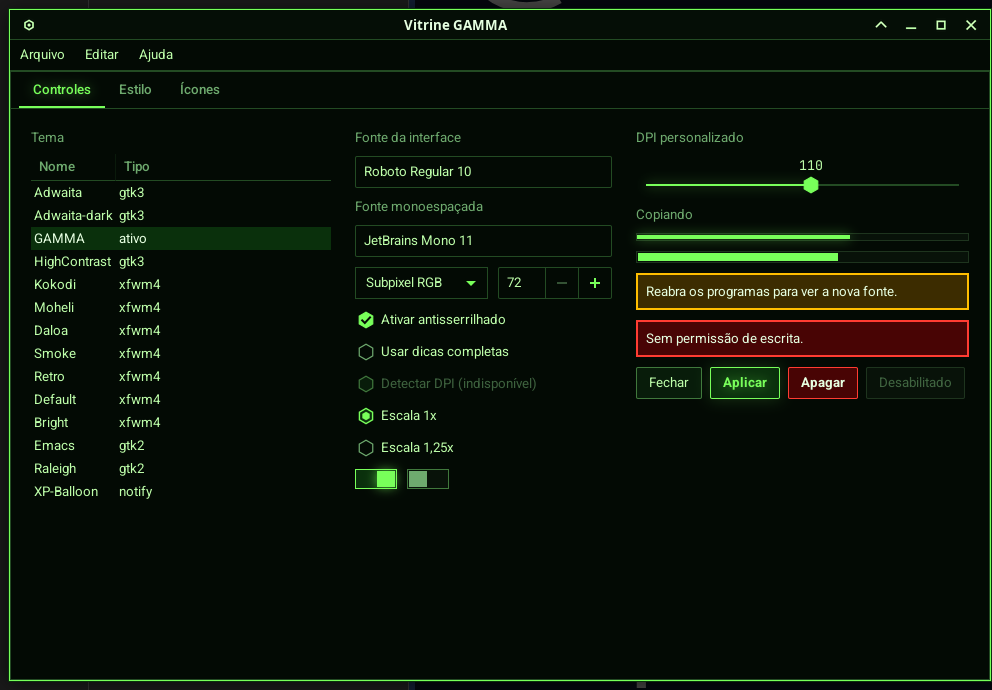
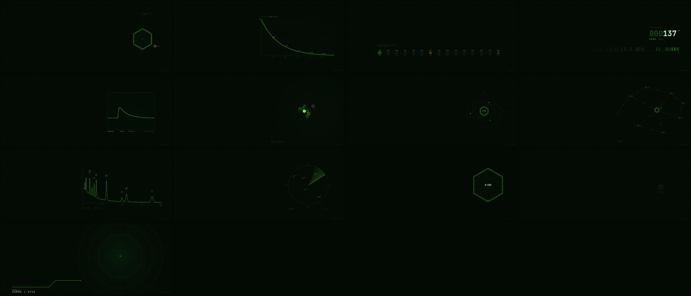
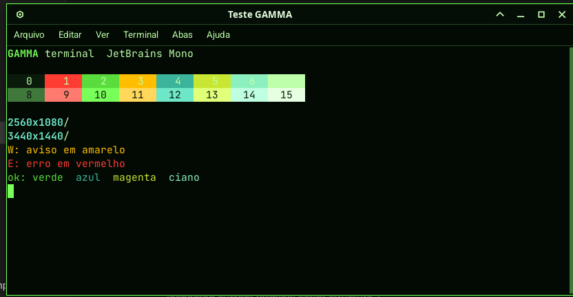

<!--
  Arquivo: README.md
  Projeto: GAMMA Debian (tema Contador)
  Versão: 1.0.0
  Data e hora: 14/11/2026 19:50 (America/Sao_Paulo)
  Autoria: lstavares84, com Claude Opus 5.5 (Anthropic)
-->

# GAMMA Debian, tema Contador

Tema completo para **Debian 13 (Trixie) com XFCE 4.20**, no mesmo estilo do
[GAMMA](https://github.com/lstavares84/turzx), o painel de monitoramento para a
telinha USB de 3,5".

Estética de instrumento científico: verde fluorescente sobre fundo quase preto,
como um contador de radiação ou um osciloscópio de fósforo verde. A interface só
brilha onde há atividade. Hexágonos como assinatura visual e cores de estado com
significado fixo: **verde** normal, **âmbar** atenção, **vermelho** crítico,
**cinza** sem dado.



## O que está incluído

| Parte | Onde | Instalado em |
|---|---|---|
| Tema GTK 3 (+ GTK 2 básico) | `tema/GAMMA/gtk-3.0`, `gtk-2.0` | `~/.themes/GAMMA` |
| Molduras de janela xfwm4 | `tema/GAMMA/xfwm4` | `~/.themes/GAMMA` |
| Notificações (xfce4-notifyd) | `tema/GAMMA/xfce-notify-4.0` | `~/.themes/GAMMA` |
| Cursor original | `cursor/GAMMA-cursor` | `~/.icons/GAMMA-cursor` |
| Ícones (Papirus-Dark com pastas recoloridas) | gerados por `icones/gerar_icones.py` | `~/.icons/GAMMA` |
| Terminal (16 cores ANSI) | `terminal/gamma.theme` | `~/.local/share/xfce4/terminal/colorschemes` |
| Editor (GtkSourceView 4, Mousepad) | `editor/gamma.xml` | `~/.local/share/gtksourceview-4/styles` |
| 13 papéis de parede, 2 resoluções | `wallpapers/` | `~/.local/share/backgrounds/gamma` |
| Fontes Roboto e JetBrains Mono | `fontes/` | `~/.local/share/fonts/gamma` |
| Book de identidade visual (PDF) | `book/` | |





## Paleta

| Nome | Código | Uso |
|---|---|---|
| bg | `#030A04` | fundo principal |
| accent | `#78FF5A` | títulos, seleção, foco, ícones ativos |
| ice | `#BEFFAA` | texto principal e valores normais |
| white | `#E6FFE1` | texto neutro de maior destaque |
| sub | `#6EAA6E` | rótulos, texto secundário, desabilitado |
| dim | `#234B23` | bordas, divisórias, grades |
| amber | `#FFBE00` | atenção, aviso |
| red | `#FF3C32` | erro, crítico |

Superfícies de estado (preenchimento / borda): OK `#0A300C / #78FF5A`,
atenção `#3C2C00 / #FFBE00`, crítico `#480404 / #FF3C32`,
sem dado `#081209 / #1E341E`, neutro `#081C0A / #40783C`.

## Instalação

Requisitos: Debian 13 com XFCE 4.20, `python3`, `xfconf-query`, `fc-cache`.
Opcional: `papirus-icon-theme` (ícones) e `python3-gi` (vitrine de teste).

```bash
git clone https://github.com/lstavares84/gamma_debian_theme.git
```

```bash
cd gamma_debian_theme && ./instalar.sh
```

Não precisa de sudo. O script copia os arquivos para a sua pasta pessoal, guarda
as configurações atuais em `~/.local/share/gamma-theme/backups/` e aplica o tema.

Opções: `--sem-aplicar` (só copia), `--sem-wallpaper` (não mexe no fundo),
`--intervalo MIN` (troca dos papéis de parede, padrão 30 minutos).

### Voltar ao tema anterior

```bash
~/.local/share/gamma-theme/restaurar.sh
```

Com `--remover`, também apaga os arquivos instalados.

## Papéis de parede que se trocam sozinhos

O instalador liga a troca automática nativa do xfdesktop em cada monitor
conectado: telas com 3000 px de largura ou mais recebem a série 3440x1440, as
demais recebem 2560x1080. Ordem aleatória, a cada 30 minutos, em todas as
áreas de trabalho. A versão 2560x1080 é a mesma arte reduzida a 75%, para que o
desenho tenha o mesmo tamanho físico em dois monitores de 34".

## Ferramentas

Os arquivos gerados podem ser refeitos a partir dos scripts em `ferramentas/`:

| Script | Gera |
|---|---|
| `gerar_assets_gtk.py` | hexágonos SVG das caixas de seleção, opções e deslizante |
| `gerar_xfwm4.py` | imagens PNG e `themerc` das molduras de janela |
| `gerar_cursor.py` | tema de cursor (requer `xcursorgen`, pacote x11-apps) |
| `gamma_config.py` | aplica e restaura as configurações do XFCE |
| `vitrine.py` | janela de teste com os controles GTK |
| `book/fonte/` | HTML que gera o book e os papéis de parede |

## Limitações conhecidas

- Aplicativos GTK 4 com libadwaita não usam temas GTK 3 e ficam no visual padrão.
- O xfce4-notifyd 0.9.7 não diferencia urgência no CSS: todas as notificações
  usam a borda verde.
- O paginador do painel desenha as áreas de trabalho como retângulos; não é
  possível torná-las hexágonos só com CSS.
- O cursor novo aparece em todos os programas depois de sair e entrar na sessão.
- Tamanho e plugins do painel não são alterados; o tema só muda a aparência.

## Fontes e licenças

- Código, tema, cursor, papéis de parede e book: criação original, licença MIT
  (veja `LICENSE`).
- Papel de parede 13 (Retícula): composição baseada numa imagem de referência
  fornecida pelo autor, redesenhada com a paleta GAMMA.
- [Roboto](https://github.com/googlefonts/roboto-classic) e
  [JetBrains Mono](https://github.com/JetBrains/JetBrainsMono): SIL Open Font
  License 1.1, arquivos obtidos do repositório
  [google/fonts](https://github.com/google/fonts). Textos das licenças em `fontes/`.
- Ícones: derivados do [Papirus](https://github.com/PapirusDevelopmentTeam/papirus-icon-theme)
  (GPL-3.0), gerados localmente na instalação a partir do pacote do Debian. Nenhum
  arquivo do Papirus é distribuído neste repositório.
- Meias-vidas da cadeia do U-238 e picos do espectro gama nos papéis de parede:
  valores físicos publicados.
